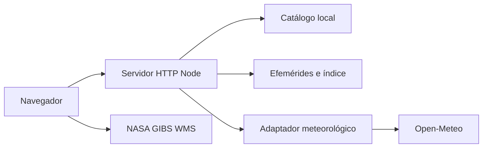

# Arquitectura

- `public/` contiene HTML, CSS y un módulo ES para interacción. La cuadrícula georreferenciada usa el mismo cuadro EPSG:4326 para puntos y WMS.
- `src/server.mjs` gestiona validación, rutas cerradas, errores y cabeceras. El navegador obtiene meteorología por el mismo origen y las imágenes satelitales directamente desde NASA.
- `src/domain/` contiene catálogo, cálculos y normalización. TypeScript verifica el dominio JavaScript con JSDoc y modo estricto.
- `scripts/build.mjs` empaqueta código y estáticos en `dist/`. En producción ejecutar `node dist/src/server.mjs` con Node 22.16+, configurar `HOST=0.0.0.0` y el puerto del proveedor. Para exposición pública usar proxy TLS, límites de solicitudes y monitoreo.
- Cada consulta puede disparar hasta cinco peticiones meteorológicas en paralelo. Antes de tráfico público agregar caché por punto y hora, cuotas, observabilidad y contrato del proveedor.
- PostGIS puede alojar lugares, polígonos de acceso y metadatos raster. Reservas reales requieren transacciones, control de inventario, idempotencia y auditoría.
